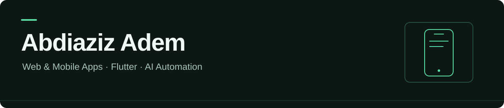

I build web applications and AI automations, and I have learned Flutter. My next focus is building mobile apps with Flutter and Dart.

[LinkedIn](https://www.linkedin.com/in/abdiaziz-adem-202900412)

[Featured project](https://github.com/Abdiaziz-Adem/Xogtamar-ai-showcase) · [Interface demo](https://xogtamar-ai.netlify.app/) · [Ask Nafiis](https://github.com/Abdiaziz-Adem/ask-nafiis)

## Selected work

### XogTamar AI — spreadsheet analytics

A local application for understanding solar, electrical, and general spreadsheet data. It combines a Next.js interface with FastAPI and Pandas calculations, chart choices, and Excel reports.

- **Problem:** Turn raw spreadsheet measurements into understandable results without inventing numerical answers.
- **Approach:** Validate files, calculate with Python, disclose missing data, and let the user choose a chart. Optional Ollama translates questions into supported analysis plans.
- **Public evidence:** Selected Python and React code, synthetic fixtures, a runnable calculation example, regression checks, and architecture notes.
- **Status:** The public website is a synthetic-data interface demo. Uploads and live AI inference are available in the complete local project, not on that website.

[Explore the showcase](https://github.com/Abdiaziz-Adem/Xogtamar-ai-showcase) · [Try the interface demo](https://xogtamar-ai.netlify.app/)

### Ask Nafiis — hotel AI assistant

The guest-facing chatbot integration for our hotel management system. It combines an Ask Nafiis chat widget and public-data answer modules with a reusable n8n/Ollama workflow and short conversation memory.

- **Focus:** Local model integration, workflow configuration, and a clear boundary between chat responses and external actions.
- **Status:** Importable workflow and source samples; running it requires your own n8n and Ollama installation.

[Explore Ask Nafiis](https://github.com/Abdiaziz-Adem/ask-nafiis)

## Technologies and current focus

| Area | Tools |
| --- | --- |
| Mobile development — next focus | Flutter, Dart |
| Web interfaces | Next.js, React, TypeScript, Tailwind CSS |
| APIs and analysis | Python, FastAPI, Pandas, OpenPyXL |
| Data persistence | PostgreSQL, SQLite |
| AI and automation | Ollama, n8n |
| Development and deployment | Git, GitHub, Docker Compose, Netlify |

## What I am developing next

My next project will be a mobile app built with Flutter. I am focusing on app interfaces, navigation, state management, and connecting apps to backend services. I use AI coding tools during development and document the scope and limitations of each project.

## Explore my work

Start with the two featured repositories above for runnable examples and implementation details. Other repositories may include learning material or community resources; their original attribution is retained.
